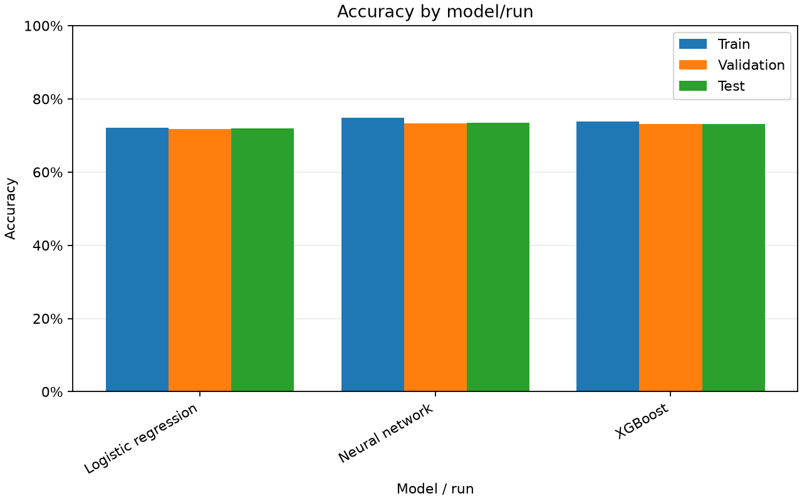
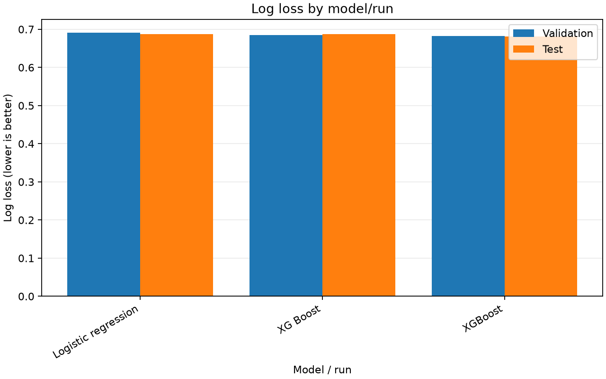
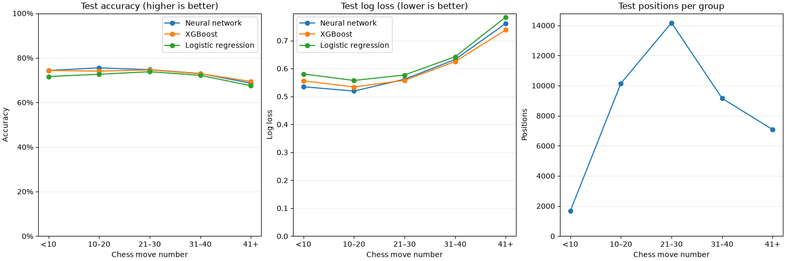

# Chess Game Outcome Predictor

Predict white wins, black wins, and draws from positions in Lichess games using
player ratings, engineered chess features, and the actual board state.

I mainly built this project to get more hands on with ML and actually understand
the progression from a simple baseline, to XGBoost, to building and training a
neural network in PyTorch.

The project currently compares three models:

- Logistic regression
- XGBoost
- A CNN-based neural network

The neural network hasn't consistently outperformed the simpler models yet, which
was admittedly not what I was hoping for, but figuring out why ended up being one
of the more interesting parts of the project.

## Data

The dataset is built from the March 2016 Lichess rated standard games archive.

The compressed PGN file is streamed and parsed game by game with `python-chess`.
Each game is replayed and selected positions are written to a processed CSV instead
of loading the entire archive into memory.

The current version samples positions from the **last third of each game**. I
originally sampled positions from across the entire game, but found that early
positions tend to be dominated by player rating and contain much less useful
board specific information about the eventual result.

Each position contains features including:

- White and Black Elo
- Elo difference
- move number
- piece counts and material difference
- side to move
- castling rights
- check status
- legal move count
- FEN
- piece locations for all 12 colour/piece combinations

For the neural network, the piece locations are stored as bitboards and converted
into a `12 x 8 x 8` tensor.

The dataset is split **by game**, not by individual position:

```text
70% training
15% validation
15% test
```

This keeps multiple positions from the same game from leaking between splits.

## Models

### Logistic Regression

Logistic regression is the basic linear baseline and uses the engineered game and
board features.

Despite being the simplest model, it ended up being surprisingly competitive.

### XGBoost

XGBoost uses the same tabular features but can learn nonlinear relationships and
interactions between them.

It generally performs around the same level as, or slightly better than, logistic
regression.

### Neural Network

The neural network uses a CNN to learn directly from the spatial board
representation.

```text
12 x 8 x 8 board
      ↓
convolution layers
      ↓
board representation
      ↓
concatenate game metadata
      ↓
fully connected layers
      ↓
White win / Black win / Draw
```

The metadata is standardized using statistics from the training set only.

The model also uses dropout, weight decay, and validation loss checkpointing to
limit overfitting.

## Results

One thing that became pretty obvious while working on this was that predicting a
game from an early position is a very different problem from predicting it later
on.

When I sampled positions throughout the entire game, the neural network was only
around the high 60% accuracy range. An ablation with a metadata only network showed
that Elo and basic game context already explain a large amount of that performance.

The actual board became much more useful later in games. In one experiment, the
hybrid neural network improved over the metadata only network by roughly:

```text
<10       +0.2%
10–20     +2.7%
21–30     +5.9%
31–40     +8.7%
41+      +14.0%
```

This was the main reason I switched the current dataset to positions from the last
third of each game.

On the current dataset, all three models reach roughly the low to mid 70% accuracy
range. The neural network still does **not consistently outperform XGBoost or
logistic regression**, so improving the board model is the main thing I want to
continue experimenting with.

## Plots

Charts show the latest run of each model. Accuracy is better when higher; log loss
is better when lower.





The stage comparison evaluates test positions at moves `<10`, `10–20`, `21–30`,
`31–40`, and `41+`.

The stored move value is technically a **ply number**, meaning White and Black
moves are counted separately.

Counts show the number of sampled test positions rather than distinct games.



Run history is saved in:

```text
results/experiments.csv
results/experiments_by_move_count.csv
```

## What I Learned

A few of the main things I ended up learning through this project:

- how to stream and process a large compressed PGN dataset
- why positions from the same game need to stay in the same data split
- how logistic regression and gradient boosted trees behave on tabular features
- how PyTorch `Dataset`, `DataLoader`, training loops, and evaluation work
- how to represent a chess board as CNN input using bitboards
- how feature scaling affects neural network training
- how quickly training loss can become misleading when a model starts overfitting
- how dropout, weight decay, and validation checkpointing help with generalization
- how ablation testing can show whether part of a model is actually useful
- how much the definition and sampling of a dataset can change the problem being solved

The biggest takeaway was probably that making the model more complicated does not
automatically make it better. The simpler models are still extremely competitive,
and improving the neural network is something I want to keep working on separately.

## Run

Use Python 3.14+ and `uv`.

Place the March 2016 rated standard games archive at (or feel free to test with another
set of games found [here](https://database.lichess.org/)):

```text
data/raw/lichess_db_standard_rated_2016-03.pgn.zst
```

Then run from the project root:

```sh
uv sync

uv run python -m chess_game_outcome_predictor.train_logistic
uv run python -m chess_game_outcome_predictor.train_xgboost
uv run python -m chess_game_outcome_predictor.train_nn
```

All models use the same game level training, validation, and test split so their
results can be compared directly.